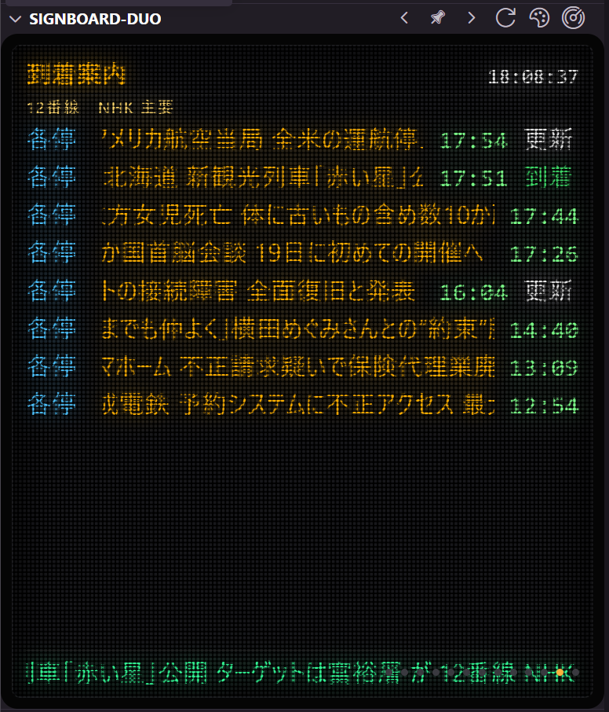
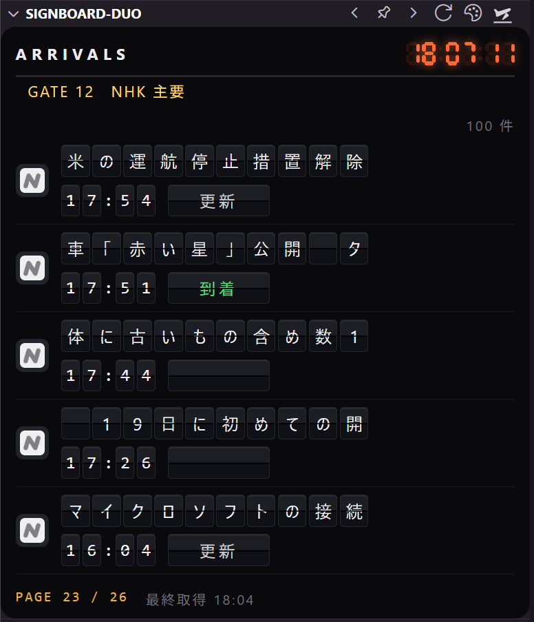
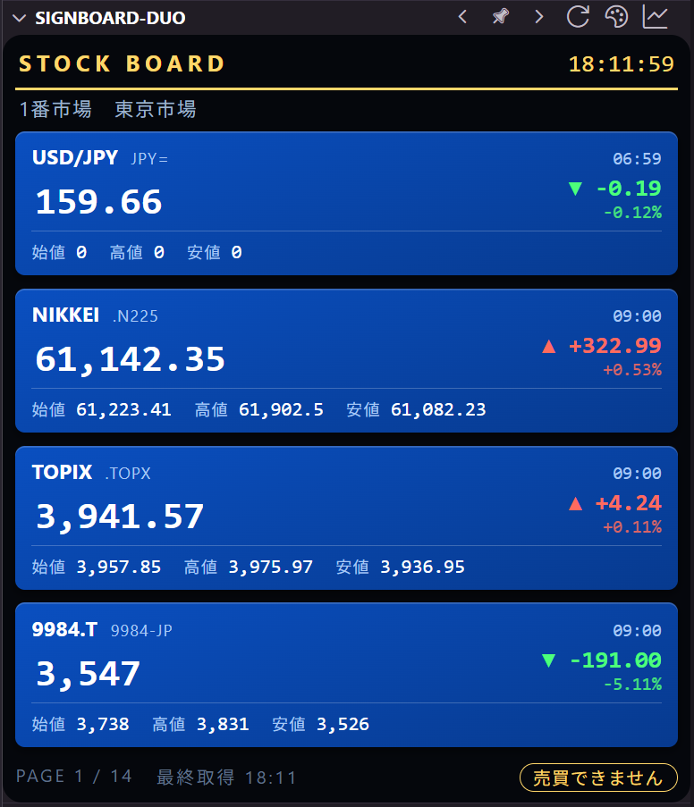

# Signboard-Duo

[](package.json)
[](https://marketplace.visualstudio.com/items?itemName=masanori-satake.signboard-duo)
[](https://open-vsx.org/extension/masanori-satake/signboard-duo)
[](https://github.com/masanori-satake/Signboard-Duo/releases)

<p align="center">
  <strong>Language / 言語:</strong> <a href="#english">English</a> | <a href="#japanese">日本語</a>
</p>

---

<a id="english"></a>
## English

**Signboard-Duo** is a VS Code extension that shows your RSS & Atom feeds — and CI results — on the boards of Signboard-Solo: an airport split-flap board, a station LED board, and a securities-style stock board, in a section of the Explorer. Each feed is a platform (a gate, a track), and every topic arrives like a plane or a train.

It is the first "-Duo": where a "-Solo" is complete on its own and fully local, a "-Duo" works by pairing with something else — here, the feeds you choose. The pairing stays minimal: read-only polling of the URLs you configure, nothing more.

Current version: **v1.1.2**

---

<a id="en-screenshots"></a>
### 📸 Screenshots

**LED board** — a station departure board behind a dot mask. Long headlines scroll so they can be read to the end, and the announcement line at the bottom highlights the line name, the arrival count and the last fetched time.



**Split-flap board** — airport arrivals, one flap tile per character, flipping over to the next page when a platform has more topics than fit.



**Stock board** — quotes as securities panels: the current price is large, the change is coloured (up is red, down is green) and the day's open / high / low ride underneath.



---

<a id="en-toc"></a>
### 📑 Table of Contents

- [📸 Screenshots](#en-screenshots)
- [💡 Key Features](#en-key-features)
- [📦 Installation & Updates](#en-installation)
- [🚀 How to Use](#en-how-to-use)
- [📋 Starter Feeds](#en-starter-feeds)
- [🔎 Finding Feeds](#en-finding-feeds)
- [⌨️ Commands](#en-commands)
- [🔧 Settings](#en-settings)
- [📋 Requirements](#en-requirements)
- [🔒 Data Storage & Privacy](#en-privacy)
- [🛡️ Security](#en-security)
- [🧭 Roadmap](#en-roadmap)
- [🛠️ Developer Documentation](#en-developer-docs)
- [📄 License](#en-license)

---

<a id="en-key-features"></a>
### 💡 Key Features

1. **Three Boards, One Button**
   - A title-bar button rotates the board style: **split-flap → LED → stock board**. The button's glyph follows the board you are looking at.
   - On the flap board each feed is a **GATE**; on the LED board, a platform track; on the stock board, a market.
   - The stock board carries a small **"No trading"** badge, so nobody at the office mistakes it for real trading — the flap and LED boards need no such note: their motifs give the joke away at a glance.

2. **Feeds as Platforms**
   - Up to **20 feeds** (RSS 1.0 / RSS 2.0 / Atom), one platform per page, polled with conditional requests (ETag / Last-Modified).
   - Topics arrive with the board's animation; a topic that leaves the feed stays on the board for `keepHours`, then departs. Click a row to open its link.
   - The flap board's logo cell shows each site's own **favicon**; the LED board's announcement line greets you in the name of the platform on screen.
   - Bamboo build-result feeds (`"kind": "bamboo"`) show failed builds as cancelled.

3. **Long Headlines, Readable**
   - LED headlines scroll **one way** (never bouncing back against the reading direction); flap headlines flip through in segments.
   - A page never rotates away before its longest headline has been shown in full.
   - The flap **remark plate shows status words only** (arrived / updated / suspended), so only one text per row ever moves — feed descriptions live in the row tooltip.

4. **Colour Themes**
   - A title-bar palette button cycles **Duo Green / Lime / Ice**; the choice is remembered.

5. **Read-Only by Design**
   - The only network traffic is GET polling of the URLs **you** configure. No telemetry, no tracking, no sending anything anywhere.
   - Tokens for authenticated feeds live in VS Code **SecretStorage** — settings hold only the auth *type*.

---

<a id="en-installation"></a>
### 📦 Installation & Updates

#### Method 1: Install from Visual Studio Marketplace (Recommended)

##### A. Install via VS Code UI
1. Open VS Code and click the **Extensions icon** on the Activity Bar (`Ctrl+Shift+X` / `Cmd+Shift+X`).
2. Search for `Signboard-Duo`.
3. Click the **Install** button.

##### B. Install via Web Browser
1. Visit the [Signboard-Duo Marketplace Page](https://marketplace.visualstudio.com/items?itemName=masanori-satake.signboard-duo).
2. Click **Install** and follow the browser prompts to open and install in VS Code.

---

#### Method 2: Install from Open VSX Registry

For VSCodium, Gitpod, Eclipse Theia, or environments configured with Open VSX:
1. Visit the [Signboard-Duo Open VSX Page](https://open-vsx.org/extension/masanori-satake/signboard-duo).
2. Install via your editor's extension manager or download the `.vsix` package directly.

---

#### Method 3: Install from VSIX Package File (Offline / Manual)

1. Go to the [GitHub Releases](https://github.com/masanori-satake/Signboard-Duo/releases) page.
2. Download the `.vsix` file (e.g., `signboard-duo-1.1.2.vsix`) under Assets.
3. In VS Code Extensions view (`Ctrl+Shift+X`), click the **"..." (Views and More Actions)** icon at the top right, select **Install from VSIX...**, and choose the downloaded file.

---

<a id="en-how-to-use"></a>
### 🚀 How to Use

#### 1. Open the board
Open the **Explorer** and expand the **Signboard-Duo** section. With no feeds configured yet, a guidance platform explains what to do.

#### 2. Add feeds
Add feeds to `signboardDuo.feeds` in your `settings.json` — the [Starter Feeds](#en-starter-feeds) below are copy-paste ready. The board starts moving on the next poll (or run **Signboard-Duo: Refresh Feeds Now**).

#### 3. Switch the board and the theme
- The **rightmost title-bar button** rotates flap → LED → stock board; its glyph always shows the current board.
- The **palette button** cycles the colour theme (Duo Green / Lime / Ice).
- The **previous / next platform** buttons move between feeds, and the **pin** button holds the current platform (auto-rotation and new-arrival jumps pause while pinned). Scrolling the mouse wheel over the LED board also moves platforms.

#### 4. Read the board
- New topics arrive with a flap / LED flourish, and the board jumps to their platform (unless pinned).
- Topics that leave the feed remain for the feed's `keepHours`, marked as updated when their title changes.
- Click a row to open the topic in your browser.

#### 5. Move it somewhere else
Drag the **Signboard-Duo** section header to the secondary side bar (right side) or the panel. VS Code remembers where you put it.

---

<a id="en-starter-feeds"></a>
### 📋 Starter Feeds

A mix for English readers: link culture, world news, and tech press. Copy the whole block into your `settings.json`.

```jsonc
"signboardDuo.feeds": [
  { "id": "hacker-news", "name": "Hacker News", "url": "https://news.ycombinator.com/rss", "maxItems": 5, "keepHours": 12 },
  { "id": "bbc-news", "name": "BBC News", "url": "https://feeds.bbci.co.uk/news/rss.xml", "maxItems": 5, "keepHours": 12 },
  { "id": "the-verge", "name": "The Verge", "url": "https://www.theverge.com/rss/index.xml", "maxItems": 5, "keepHours": 24 },
  { "id": "github-blog", "name": "GitHub Blog", "url": "https://github.blog/feed/", "maxItems": 4, "keepHours": 48 },
  { "id": "vscode-releases", "name": "VS Code Releases", "url": "https://github.com/microsoft/vscode/releases.atom", "maxItems": 4, "keepHours": 72 }
],
"signboardDuo.pollMinutes": 15
```

#### Stock quotes

Set `"kind": "stock"` on a feed that returns quotes as JSON (CNBC quote shape) and the platform renders as securities-style panels on the stock board: name and symbol in the head, the current price big and white, the change coloured by direction (red up / green down, Japanese convention), and a quiet Open / High / Low strip.

For US markets (S&P 500, Dow, Nasdaq, Apple, USD/JPY):

```jsonc
{ "id": "markets-us", "name": "US Markets", "kind": "stock", "maxItems": 10,
  "url": "https://quote.cnbc.com/quote-html-webservice/restQuote/symbolType/symbol?symbols=SPX%7C.DJI%7C.IXIC%7CAAPL%7CJPY%3D&requestMethod=itv&noform=1&partnerId=2&fund=1&exthrs=1&output=json" }
```

Note: that endpoint is a public, unofficial one — it may change or stop without notice, and quotes may be delayed. Symbols use CNBC's notation (`.N225`, `.TOPX`, `SPX`, `JPY=`, `9984-JP`, …); a symbol the provider does not know is simply skipped.

---

<a id="en-finding-feeds"></a>
### 🔎 Finding Feeds

Many sites publish RSS/Atom feeds without making a fuss about them. A few ways to find one for a site you like:

1. **Look for the icon or a link** — an orange RSS icon, or a "RSS / Atom / Feed" link in the site's footer or sidebar.
2. **Try the usual addresses** — add `/feed/` to the site's URL (WordPress sites), or try `/rss`, `/rss.xml`, `/atom.xml`, `/index.xml`. The starter lists above are all examples of these patterns.
3. **GitHub is all feeds** — append `.atom` to a repository's releases or commits page (`https://github.com/<owner>/<repo>/releases.atom`). Issues and pull requests have feeds too.
4. **Peek at the page source** — open the site's top page, view its HTML source (right-click → "View page source"), and search for `application/rss+xml`. The `href` next to it is the feed URL the site itself declares.
5. **Microsoft 365** — the Microsoft 365 Roadmap offers RSS: filter the roadmap view to the products you care about, then use the RSS icon above the filters to get that view's feed URL. Official Microsoft blogs publish feeds as well. SharePoint lists can also emit RSS (List Settings → RSS Settings), but they sit behind Microsoft 365 sign-in, which Duo's token types cannot perform — so SharePoint feeds are not usable here in practice.
6. **Check before you paste** — open the candidate URL in a browser. A feed shows as raw XML text; if you see a normal web page, it is not a feed. If Duo shows a fetch error for a feed, the URL is usually a page rather than a feed.

---

<a id="en-commands"></a>
### ⌨️ Commands

| Command Name | Command ID | Description |
| :--- | :--- | :--- |
| **Show Flap Board** | `signboardDuo.showFlap` | Switch the board to the split-flap style |
| **Show LED Board** | `signboardDuo.showLed` | Switch the board to the LED style |
| **Show Stock Board** | `signboardDuo.showStock` | Switch the board to the stock style |
| **Switch Board Style** | `signboardDuo.cycleMode` | Rotate flap → LED → stock (the title-bar button) |
| **Switch Colour Theme** | `signboardDuo.cycleTheme` | Cycle Duo Green / Lime / Ice |
| **Refresh Feeds Now** | `signboardDuo.refresh` | Fetch all feeds immediately |
| **Previous Platform** | `signboardDuo.prevPlatform` | Move to the previous feed's platform |
| **Next Platform** | `signboardDuo.nextPlatform` | Move to the next feed's platform |
| **Pin This Platform** | `signboardDuo.pinPlatform` | Hold the current platform (pauses rotation and jumps) |
| **Unpin Platform** | `signboardDuo.unpinPlatform` | Release the pin |
| **Set Feed Token** | `signboardDuo.setToken` | Store a feed's token in SecretStorage |
| **Delete Feed Token** | `signboardDuo.deleteToken` | Remove a feed's stored token |

---

<a id="en-settings"></a>
### 🔧 Settings

| Setting | Default | Description |
| :--- | :--- | :--- |
| `signboardDuo.feeds` | `[]` | Feeds shown as platforms (up to 20). Each feed: `id`, `name`, `url`, `kind` (`generic` / `bamboo` / `status` / `jma` / `stock`), `enabled`, `maxItems`, `keepHours`, `auth` (type only) |
| `signboardDuo.pollMinutes` | `15` | Feed polling interval in minutes (minimum 5) |
| `signboardDuo.mode` | `flap` | Board style: `flap` / `led` / `stock`, or `auto` (flap below 540px, LED at 540px and wider) |
| `signboardDuo.scrollLongText` | `true` | Scroll (LED) or flip through (flap) long titles instead of truncating them |
| `signboardDuo.ledPitch` | `3` | LED dot pitch in px |
| `signboardDuo.ledHole` | `38` | LED hole size, as a percentage of the dot pitch |
| `signboardDuo.ledGlow` | `true` | Add a soft glow behind the LED board's letters |

Settings can be changed via VS Code Settings (`Ctrl+,` / `Cmd+,`).

#### Authenticated feeds

For feeds with `auth`, run **Signboard-Duo: Set Feed Token** to store the secret in SecretStorage; only the auth type lives in settings. Bamboo build-result feeds use `"kind": "bamboo"` (failed builds show as cancelled).

---

<a id="en-requirements"></a>
### 📋 Requirements

- **VS Code**: `v1.90.0` or later
- **OS**: Windows, macOS, Linux
- Network access to the feed URLs you configure. No accounts or API keys, unless your own feeds require tokens.

---

<a id="en-privacy"></a>
### 🔒 Data Storage & Privacy

The only network traffic is read-only GET polling of the feed URLs you configured (with ETag / Last-Modified conditional requests). There is no telemetry and no tracking, and nothing is sent anywhere else. The latest topics are kept in VS Code's standard extension storage on your machine so the board survives restarts; feed tokens are in SecretStorage, never in settings. The board also loads each feed's favicon from that feed's own origin, as an image.

---

<a id="en-security"></a>
### 🛡️ Security

Feed content is treated as untrusted text and can never turn into code:

- The parser is hand-rolled and resolves no external entities (no XXE, no entity-expansion attacks); entity decoding is a single pass into plain text, and descriptions have their markup stripped before display.
- Every renderer inserts feed text as text, never as HTML, and the webview runs under a strict Content Security Policy (`default-src 'none'`, nonce-only scripts, images over https only) — even a crafted headline stays inert text on the board.
- Clicking a row opens only `http://` / `https://` links. Fetches go only to the URLs you configured, with a 10-second timeout, a 1 MB body cap and at most 5 redirects.
- What remains: a feed you choose can still show misleading headlines as plain text — pick feeds you trust.

---

<a id="en-roadmap"></a>
### 🧭 Roadmap

- Bamboo build-result title patterns, once a real Bamboo RSS sample is available.
- Live-state providers (Bamboo / GitHub Actions REST APIs) alongside the RSS core.
- More sources in the same shape: pull requests, AI-agent sessions.
- Real train information (public-transport open data) — the current challenge dataset has no Sagami Railway (Sotetsu) data, so this waits.

---

<a id="en-developer-docs"></a>
### 🛠️ Developer Documentation

- Development and release rules for contributors and AI agents: [AGENTS.md](AGENTS.md)
- Build & test:

```bash
npm run check        # syntax check for all JS
npm test             # unit tests (node --test)
npm run package      # build the VSIX
npm run check-version
```

---

<a id="en-license"></a>
### 📄 License

[MIT License](LICENSE)

---

<a id="japanese"></a>
## Japanese (日本語)

**Signboard-Duo** は、RSS / Atom フィードや CI の結果を、Signboard-Solo の盤面——空港のフラップ盤、駅の LED 盤、証券ボード風の株価ボード——で眺める VS Code 拡張です。エクスプローラーのセクションに常駐します。フィードが「番線／ゲート」、届いたトピックが「電車／飛行機」になります。

初の「-Duo」です。「-Solo」が単体完結・完全ローカルなのに対して、「-Duo」は何かと組んで初めて成り立ちます。ここでの相手は、あなたが選んだフィードです。連携は最小限に留めます。設定した URL への読み取り専用のポーリング、それだけです。

現在のバージョン: **v1.1.2**

---

<a id="ja-screenshots"></a>
### 📸 スクリーンショット

**LED ボード** ─ 駅の発車標をドットマスク越しに。長い見出しは最後まで読めるように流れ、最下行の案内では線名・到着件数・最終取得時刻が色を変えて点滅します。


**フラップボード** ─ 空港の到着盤。1文字1枚のタイルで、番線の件数が入りきらないときはページがめくれます。


**株価ボード** ─ 証券ボード式のパネル。現在値を大きく、前日比は色で（上昇＝赤、下落＝緑）、下段に始値・高値・安値を並べます。


---

<a id="ja-toc"></a>
### 📑 目次

- [📸 スクリーンショット](#ja-screenshots)
- [💡 主な機能](#ja-key-features)
- [📦 インストール/アップデート方法](#ja-installation)
- [🚀 使い方](#ja-how-to-use)
- [📋 スターターフィード](#ja-starter-feeds)
- [🔎 フィードの探し方](#ja-finding-feeds)
- [⌨️ コマンド](#ja-commands)
- [🔧 設定](#ja-settings)
- [📋 動作要件](#ja-requirements)
- [🔒 データの保存について](#ja-privacy)
- [🛡️ セキュリティ](#ja-security)
- [🧭 ロードマップ](#ja-roadmap)
- [🛠️ 開発者向けドキュメント](#ja-developer-docs)
- [📄 ライセンス](#ja-license)

---

<a id="ja-key-features"></a>
### 💡 主な機能

1. **3つの盤面、ボタン1つで切替**
   - ビューのタイトルバーのボタンで、盤面スタイルが **フラップ → LED → 株価ボード** とローテートします。ボタンのグリフは、いま見ている盤面に追従します。
   - フラップではフィードが **GATE**（ゲート）、LED では番線、株価ボードでは市場になります。
   - 株価ボードには小さな **「売買できません」** バッジが付きます。仕事中に同僚が見ても株の売買と誤解されないためです。フラップと LED は見た瞬間にモチーフが分かるので、注釈は不要です。

2. **フィード＝番線**
   - 最大 **20件** のフィード（RSS 1.0 / RSS 2.0 / Atom）を、1フィード＝1ページで表示します。取得は条件付きリクエスト（ETag / Last-Modified）です。
   - トピックは盤面のアニメーションで到着し、フィードから消えても `keepHours` の間は盤面に残ってから発ちます。行をクリックするとリンクが開きます。
   - フラップのロゴ欄には各サイト自身の **ファビコン**、LED のテロップは表示中の番線の名前で挨拶します。
   - Bamboo のビルド結果フィード（`"kind": "bamboo"`）では、失敗したビルドが運休として表示されます。

3. **長い見出しを、読める形で**
   - LED の見出しは **一方向** にスクロールします（読みの向きに逆らう往復はしません）。フラップは区切りめくりです。
   - ページは、そのページで一番長い見出しが最後まで表示されるまで、次のページに移りません。
   - フラップの **備考プレートはステータス表示（到着／更新／運休）に徹します**。1行の中で動く文字は1つだけにし、フィードの概要文は行のツールチップで読めます。

4. **配色テーマ**
   - タイトルバーのパレットボタンで **Duo Green / Lime / Ice** を切り替えます。選択は記憶されます。

5. **読み取り専用が設計の前提**
   - ネットワーク通信は、**あなたが設定した URL** への GET ポーリングだけです。テレメトリもトラッキングも、どこかへ何かを送ることもありません。
   - 認証フィードのトークンは VS Code の **SecretStorage** に保管し、設定には方式だけを書きます。

---

<a id="ja-installation"></a>
### 📦 インストール/アップデート方法

#### 方法 1: Visual Studio Marketplace からのインストール（推奨）

##### A. VS Code UI からインストール
1. VS Code でアクティビティバーの **拡張機能アイコン**（`Ctrl+Shift+X` / `Cmd+Shift+X`）を開きます。
2. `Signboard-Duo` で検索します。
3. **インストール** ボタンをクリックします。

##### B. Web ブラウザからインストール
1. [Signboard-Duo の Marketplace ページ](https://marketplace.visualstudio.com/items?itemName=masanori-satake.signboard-duo) を開きます。
2. **Install** をクリックし、ブラウザの案内に従って VS Code でインストールします。

---

#### 方法 2: Open VSX Registry からのインストール

VSCodium、Gitpod、Eclipse Theia など、Open VSX を使う環境向けです。
1. [Signboard-Duo の Open VSX ページ](https://open-vsx.org/extension/masanori-satake/signboard-duo) を開きます。
2. エディタの拡張機能マネージャーからインストールするか、`.vsix` パッケージを直接ダウンロードします。

---

#### 方法 3: VSIX パッケージファイルからのインストール（オフライン環境等）

1. [GitHub Releases](https://github.com/masanori-satake/Signboard-Duo/releases) ページを開きます。
2. Assets の `.vsix` ファイル（例: `signboard-duo-1.1.2.vsix`）をダウンロードします。
3. VS Code の拡張機能ビュー（`Ctrl+Shift+X`）右上の **「...」（ビューとその他のアクション）** から **VSIX からのインストール...** を選び、ダウンロードしたファイルを指定します。

---

<a id="ja-how-to-use"></a>
### 🚀 使い方

#### 1. 盤面を開く
**エクスプローラー** を開き、**Signboard-Duo** セクションを展開します。フィード未設定の間は、案内用の番線が表示されます。

#### 2. フィードを追加する
`settings.json` の `signboardDuo.feeds` にフィードを追加します。下の[スターターフィード](#ja-starter-feeds)はそのままコピペできます。次の取得タイミングで盤面が動き出します（**Signboard-Duo: フィードを今すぐ更新** ですぐ取得もできます）。

#### 3. 盤面とテーマを切り替える
- **タイトルバー右端のボタン** でフラップ → LED → 株価ボードとローテートします。グリフは常に現在の盤面を示します。
- **パレットボタン** で配色テーマ（Duo Green / Lime / Ice）を切り替えます。
- **前の番線／次の番線** ボタンでフィード間を移動し、**ピン** ボタンで現在の番線に固定します（固定中は自動送りと新着ジャンプが止まります）。LED 盤面ではマウスホイールでも番線を移動できます。

#### 4. 盤面を眺める
- 新着トピックはフラップ／LED の演出で到着し、盤面はその番線へジャンプします（ピン留め中を除く）。
- フィードから消えたトピックは、そのフィードの `keepHours` の間だけ残ります。タイトルが変わったトピックは「更新」と表示されます。
- 行をクリックすると、トピックがブラウザで開きます。

#### 5. 置き場所を変える
**Signboard-Duo** セクションの見出しを、セカンダリサイドバー（右側）やパネルへドラッグできます。置き場所は VS Code が記憶します。

---

<a id="ja-starter-feeds"></a>
### 📋 スターターフィード

日本語圏のおすすめです。そのまま `settings.json` にコピペすれば、すぐに盤面が動き出します。

```jsonc
"signboardDuo.feeds": [
  { "id": "nhk-top", "name": "NHK 主要", "url": "https://www.nhk.or.jp/rss/news/cat0.xml", "maxItems": 5, "keepHours": 12 },
  { "id": "itmedia-bursts", "name": "ITmedia 速報", "url": "https://rss.itmedia.co.jp/rss/1.0/news_bursts.xml", "maxItems": 5, "keepHours": 12 },
  { "id": "yahoo-topics", "name": "Yahoo!ニュース", "url": "https://news.yahoo.co.jp/rss/topics/top-picks.xml", "maxItems": 5, "keepHours": 12 },
  { "id": "hatena-it", "name": "はてな 人気IT", "url": "https://b.hatena.ne.jp/hotentry/it.rss", "maxItems": 4, "keepHours": 48 },
  { "id": "jma-extra", "name": "気象庁 随時", "url": "https://www.data.jma.go.jp/developer/xml/feed/extra.xml", "kind": "jma", "maxItems": 5, "keepHours": 24 }
],
"signboardDuo.pollMinutes": 15
```

#### 株価ボード

相場を JSON で返すフィードに `"kind": "stock"` を付けると、その番線は株価ボードで証券ボード風のパネル表示になります。銘柄とシンボル、大きな現在値、色で語る前日比（日本の慣例で、上昇＝赤、下落＝緑）、そして始値・高値・安値の帯が付きます。

日本向け（日経平均・TOPIX・ドル円・ソフトバンクグループ）:

```jsonc
{ "id": "markets-jp", "name": "東京市場", "kind": "stock", "maxItems": 10,
  "url": "https://quote.cnbc.com/quote-html-webservice/restQuote/symbolType/symbol?symbols=.N225%7C.TOPX%7CJPY%3D%7C9984-JP&requestMethod=itv&noform=1&partnerId=2&fund=1&exthrs=1&output=json" }
```

注意：上記エンドポイントは非公式の公開エンドポイントで、予告なく変わったり止まったりすることがあります。価格は遅延配信の場合があります。シンボルは CNBC の表記（`.N225`、`.TOPX`、`SPX`、`JPY=`、`9984-JP` など）で、提供側が知らないシンボルは単にスキップされます。

---

<a id="ja-finding-feeds"></a>
### 🔎 フィードの探し方

多くのサイトは、目立たない形で RSS/Atom フィードを公開しています。好きなサイトのフィードを見つける方法をいくつか紹介します。

1. **アイコンやリンクを探す** — オレンジ色の RSS アイコンや、サイトのフッター・サイドバーにある「RSS／Atom／フィード」のリンクが手がかりです。
2. **よくあるアドレスを試す** — サイトの URL に `/feed/` を付ける（WordPress のサイト）、`/rss`、`/rss.xml`、`/atom.xml`、`/index.xml` を試す、といった方法があります。上のスターターフィードは、どれもこのパターンの実例です。
3. **GitHub は全部フィード** — リポジトリのリリースやコミットのページ URL に `.atom` を付けるとフィードになります（`https://github.com/<owner>/<repo>/releases.atom`）。Issue やプルリクエストにもフィードがあります。
4. **ページのソースを覗く** — サイトのトップページで HTML ソースを表示し（右クリック →「ページのソースを表示」）、`application/rss+xml` を検索します。その横の `href` が、サイト自身が宣言しているフィード URL です。
5. **Microsoft 365** — Microsoft 365 ロードマップが RSS に対応しています。ロードマップの表示を関心のある製品で絞り込んでから、フィルターの上にある RSS アイコンで、その表示のフィード URL を取得します。Microsoft の公式ブログもフィードを公開しています。SharePoint のリストも RSS を出せます（リストの設定 → RSS の設定）が、Microsoft 365 のサインインの内側にあるため Duo のトークン方式では通せず、実質的には使えません。
6. **貼る前に確かめる** — 候補の URL は、まずブラウザで開いてください。XML のテキストが表示されればフィードです。通常の Web ページが見えたら、それはフィードではありません。Duo で取得エラーになる場合も、URL がフィードではなくページであることがほとんどです。

---

<a id="ja-commands"></a>
### ⌨️ コマンド

| コマンド名 | コマンド ID | 説明 |
| :--- | :--- | :--- |
| **フラップ表示に切り替え** | `signboardDuo.showFlap` | 盤面をフラップ式に切り替える |
| **LED表示に切り替え** | `signboardDuo.showLed` | 盤面を LED 式に切り替える |
| **株価ボード表示に切り替え** | `signboardDuo.showStock` | 盤面を株価ボードに切り替える |
| **盤面スタイルを切り替え** | `signboardDuo.cycleMode` | フラップ → LED → 株価ボードとローテートする（タイトルバーのボタン） |
| **配色テーマを切り替え** | `signboardDuo.cycleTheme` | Duo Green / Lime / Ice を切り替える |
| **フィードを今すぐ更新** | `signboardDuo.refresh` | 全フィードをすぐに取得する |
| **前の番線へ** | `signboardDuo.prevPlatform` | 前のフィードの番線へ移動する |
| **次の番線へ** | `signboardDuo.nextPlatform` | 次のフィードの番線へ移動する |
| **この番線をピン留め** | `signboardDuo.pinPlatform` | 現在の番線に固定する（自動送りとジャンプが止まる） |
| **ピン留めを解除** | `signboardDuo.unpinPlatform` | ピン留めを外す |
| **フィードのトークンを設定** | `signboardDuo.setToken` | フィードのトークンを SecretStorage に保存する |
| **フィードのトークンを削除** | `signboardDuo.deleteToken` | 保存したトークンを削除する |

---

<a id="ja-settings"></a>
### 🔧 設定

| 設定 | 既定値 | 説明 |
| :--- | :--- | :--- |
| `signboardDuo.feeds` | `[]` | 番線として表示するフィード（最大20件）。各フィードの項目は `id`、`name`、`url`、`kind`（`generic` / `bamboo` / `status` / `jma` / `stock`）、`enabled`、`maxItems`、`keepHours`、`auth`（方式のみ） |
| `signboardDuo.pollMinutes` | `15` | フィードの取得間隔（分、最小5） |
| `signboardDuo.mode` | `flap` | 盤面スタイル：`flap` / `led` / `stock`、または `auto`（540px 未満はフラップ、540px 以上は LED） |
| `signboardDuo.scrollLongText` | `true` | 長いタイトルを切り捨てず、LED ではスクロール、フラップでは区切りめくりで表示する |
| `signboardDuo.ledPitch` | `3` | LED のドット間隔（px） |
| `signboardDuo.ledHole` | `38` | LED の穴の大きさ（ドット間隔に対する％） |
| `signboardDuo.ledGlow` | `true` | LED の文字の後ろに柔らかなグロー（にじみ）を付ける |

設定は VS Code の設定画面（`Ctrl+,` / `Cmd+,`）から変更できます。

#### 認証フィード

`auth` を使うフィードは、コマンド **Signboard-Duo: フィードのトークンを設定** で秘密情報を SecretStorage に保存します。設定に残るのは方式だけです。Bamboo のビルド結果フィードは `"kind": "bamboo"` を使います（失敗したビルドは運休表示）。

---

<a id="ja-requirements"></a>
### 📋 動作要件

- **VS Code**: `v1.90.0` 以上
- **OS**: Windows、macOS、Linux
- 設定したフィード URL へのネットワークアクセス。自分のフィードがトークンを要求する場合を除き、アカウントや API キーは不要です。

---

<a id="ja-privacy"></a>
### 🔒 データの保存について

ネットワーク通信は、設定したフィード URL への読み取り専用の GET ポーリングだけです（ETag / Last-Modified による条件付きリクエスト）。テレメトリもトラッキングもなく、どこかへ何かを送ることもありません。最新のトピックは、再起動後も盤面が残るよう、お使いのマシン上の VS Code の標準の拡張ストレージに保存されます。フィードのトークンは SecretStorage の中だけで、設定には残りません。ファビコンは、各フィード自身の配信元から画像として読み込みます。

---

<a id="ja-security"></a>
### 🛡️ セキュリティ

フィードの内容は「信用できないテキスト」として扱い、コードには決してなりません。

- パーサは自前実装で、外部実体を解決しません（XXE や実体展開攻撃は不成立）。実体のデコードは1回だけ行われ、結果はただの文字列です。概要文は表示前にマークアップを取り除きます。
- すべての盤面で、フィードのテキストは HTML としてではなくテキストとして挿入されます。Webview には厳格な Content Security Policy（`default-src 'none'`、スクリプトは nonce のみ、画像は https のみ）を掛けているので、細工した見出しも盤面の上の無力な文字に留まります。
- 行クリックで開くのは `http://` / `https://` のリンクだけです。取得は設定した URL へのみで、タイムアウト10秒、本文上限1MB、リダイレクトは最大5回までです。
- 残るのは「選んだフィードが嘘の見出しを文字として表示すること」だけです。信頼できるフィードを選んでください。

---

<a id="ja-roadmap"></a>
### 🧭 ロードマップ

- Bamboo ビルド結果のタイトルパターン対応（実物の Bamboo RSS サンプルが手に入り次第）。
- RSS を核に、ライブ状態を取るプロバイダ（Bamboo / GitHub Actions の REST API）を追加。
- 同じ形の情報源を増やす：プルリクエスト、AI エージェントのセッション。
- 本物の電車情報（公共交通オープンデータ）。現在のチャレンジのデータセットに相鉄が無いため、保留中です。

---

<a id="ja-developer-docs"></a>
### 🛠️ 開発者向けドキュメント

- 開発とリリースのルール（貢献者と AI エージェント向け）: [AGENTS.md](AGENTS.md)
- ビルドとテスト:

```bash
npm run check        # 全 JS の構文チェック
npm test             # 単体テスト（node --test）
npm run package      # VSIX を生成
npm run check-version
```

---

<a id="ja-license"></a>
### 📄 ライセンス

[MIT License](LICENSE)
